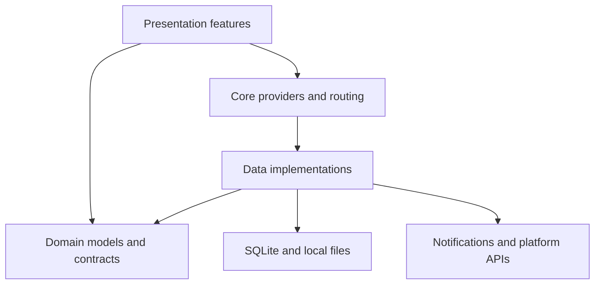

# Application Architecture

Todow is a local-first Flutter app. Presentation features use domain models and repository interfaces; local data implementations handle SQLite, files, notifications, and platform services. The app has no application server.

## Project layout

| Path | Responsibility |
| --- | --- |
| `lib/core/` | Shared routing, theme, service providers, and utilities |
| `lib/domain/` | Models, reminder rules, repository contracts, and service contracts |
| `lib/data/local/` | SQLite database and repository implementations |
| `lib/data/services/` | File storage, notifications, scheduling, and platform adapters |
| `lib/presentation/features/` | Screens, state, and widgets grouped by product area |
| `lib/presentation/shared/` | UI shared across product areas |

## Dependency direction

Presentation coordinates user interaction and state. Domain code owns product rules and contracts. Data code implements those contracts with local storage or platform APIs. Keep SQL and platform details out of presentation and domain code.

## State and persistence

- Tasks, subtasks, attachments, reminder plans, roadmaps, timetables, and focus sessions persist on the device.
- Screen state such as open forms, selected filters, and import drafts stays in presentation state until the user saves it.
- CSV, spreadsheet, and image imports produce reviewable drafts. Persist imported entries only after confirmation.
- Web and native targets use platform-specific database and notification adapters where required.

## Change guidelines

- Keep business rules in domain code or the service that owns them, not in widgets.
- Depend on domain contracts from higher-level code; keep storage and platform APIs in data implementations.
- Extend an existing feature folder before creating a new shared abstraction.
- Preserve local-first behavior. Add network services only when the product requirements call for them.
