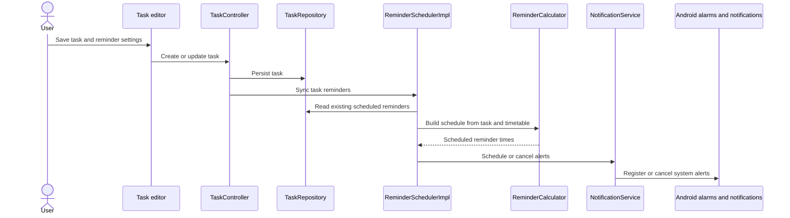
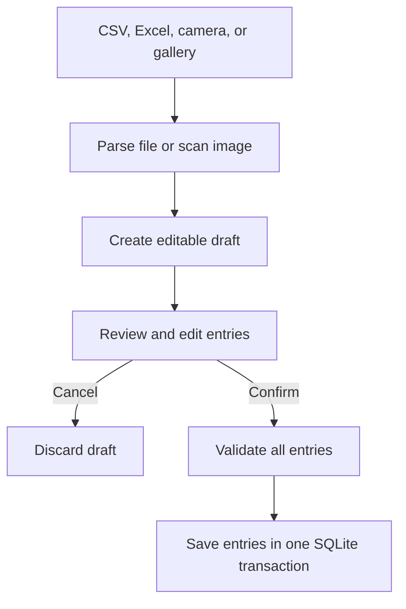

# Application Flows

## Task reminders

Completing, archiving, or deleting a task cancels its pending reminders. Snoozing changes the scheduled wake-up time for that reminder.

## Timetable import

The selected schedule remains visible during import. Imported entries are not saved until confirmation. If validation or persistence fails, the import does not leave a partial set of entries.

## Timetable schedule rules

- University entries repeat weekly.
- Personal entries can repeat weekly or use one selected date.
- Copying entries creates independent entries in the destination schedule.
- Personal entries can link to tasks.
